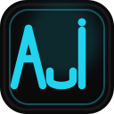

<p align="center">
  
</p>

<h1 align="center">Afaq Ul Islam — Portfolio</h1>

<p align="center">
  A premium, animated portfolio landing page for a full-stack &amp; AI engineer —
  built with <strong>Next.js 15</strong>, <strong>TypeScript</strong> and <strong>Tailwind CSS</strong>, with an
  electric laser-drawn <strong>AUI</strong> monogram, glassmorphism, and a working contact form powered by <strong>Resend</strong>.
</p>

<p align="center">
  
  
  
  
  
</p>

<p align="center">
  <a href="https://portfolio-landingpage-v2-aui.vercel.app"><strong>View live site →</strong></a>
  · <a href="https://github.com/afaqulislam"><strong>GitHub profile</strong></a>
</p>

---

## Table of Contents

- [Overview](#overview)
- [Features](#features)
- [Sections](#sections)
- [Tech Stack](#tech-stack)
- [Project Structure](#project-structure)
- [Getting Started](#getting-started)
- [Environment Variables](#environment-variables)
- [Contact Form API](#contact-form-api)
- [Scripts](#scripts)
- [Accessibility & Performance](#accessibility--performance)
- [Deployment](#deployment)
- [Contributing](#contributing)
- [License](#license)

---

## Overview

This is the personal portfolio of **Afaq Ul Islam** — Co-Founder & COO at **Neofyx**. It showcases product work, engineering experience, education and milestones in a visually meticulous, single-accent design language: dark glass surfaces, a constant cyan accent (`#22d3ee`), fluid motion and an accessibility-first build.

The showpiece is a **laser-drawn AUI monogram** in the hero — the logo builds itself stroke by stroke with an electric spark effect, holds, then redraws on a loop. No animation library; it is pure SVG `stroke-dashoffset` keyframes.

## Features

- **⚡ Electric hero logo** — the AUI monogram is drawn with a jagged, crackling laser stroke (`steps` + flicker keyframes), holds fully visible, then redraws — looped, with `prefers-reduced-motion` support.
- **✨ Glassmorphism system** — double-bezel cards, film-grain overlay, layered depth and a mouse-tracked glass wordmark in the footer (Neofyx-style shine that follows the cursor).
- **🎨 One constant accent colour** — a single cyan hue applied consistently across the entire UI.
- **📨 Working contact form** — client-side validation, sending/failure/success states, delivered via the Resend API route (`app/api/contact`).
- **📜 Scroll-reveal animations** — lightweight `IntersectionObserver` reveals that respect `prefers-reduced-motion`.
- **♿ Accessible by default** — semantic landmarks, a skip link, keyboard-friendly navigation, visible focus rings and tested colour contrast.
- **📱 Fully responsive** — fluid layouts from mobile through ultra-wide.
- **⚡ Performance focused** — server-first components, GPU-only animation and stable layout.
- **🛠 Content-driven** — all copy lives in a single `lib/data.ts` file (edit content without touching JSX).

## Sections

| Section        | Id             | Highlights                                             |
| -------------- | -------------- | ------------------------------------------------------ |
| Hero           | `#home`        | Electric AUI logo, tagline, CTAs, stats                |
| About          | `#about`       | Personal intro + details                               |
| Skills         | `#skills`      | Tech stack / capabilities                              |
| Projects       | `#work`        | Browser-window previews, GitHub links                   |
| Experience     | `#experience`  | Timeline: Neofyx, internships, freelance                |
| Education      | `#education`   | Timeline: KU, GIAIC, college, SSC                       |
| Milestones     | `#achievements`| Highlights & wins                                       |
| Contact        | `#contact`     | Resend-powered form + socials                           |

## Tech Stack

| Layer       | Technology                              |
| ----------- | --------------------------------------- |
| Framework   | Next.js 15 (App Router)                 |
| Language    | TypeScript                              |
| UI          | React 19                                |
| Styling     | Tailwind CSS 3.4                        |
| Icons       | lucide-react                            |
| Fonts       | Geist (local, via `next/font/local`)    |
| Email       | Resend (REST API)                       |
| Animation   | Native SVG / CSS keyframes              |

## Project Structure

```
portfolio-landingpage-v2/
├─ app/
│  ├─ api/
│  │  └─ contact/route.ts   # Resend email delivery endpoint
│  ├─ components/           # Section + layout components
│  │  ├─ hero-logo.tsx      # Electric AUI laser monogram
│  │  ├─ glass-wordmark.tsx # Mouse-tracked footer wordmark
│  │  └─ ...                # about, skills, projects, education, ...
│  ├─ fonts/                # Geist variable fonts
│  ├─ globals.css           # Design tokens, utilities, base styles
│  ├─ layout.tsx            # Root layout, metadata, backdrop
│  └─ page.tsx              # Section composition
├─ lib/
│  ├─ data.ts               # All site content (edit here)
│  └─ utils.ts              # `cn` class-merge helper
├─ public/
│  ├─ projects/             # Project preview SVGs
│  ├─ aui-mark.svg          # AUI monogram (header/footer/README)
│  └─ Afaq_Ul_Islam_Resume.pdf
├─ tailwind.config.ts
└─ next.config.ts
```

## Getting Started

### Prerequisites

- Node.js **18.18** or newer
- npm

### Installation

```bash
# 1. Clone the repository
git clone https://github.com/afaqulislam/portfolio-landingpage-v2.git
cd portfolio-landingpage-v2

# 2. Install dependencies
npm install

# 3. Set up environment variables
cp .env.example .env
# → then fill in your RESEND_API_KEY

# 4. Run the dev server
npm run dev
```

Open [http://localhost:3000](http://localhost:3000) in your browser.

## Environment Variables

| Variable          | Required | Default                              | Description                                        |
| ----------------- | -------- | ------------------------------------ | -------------------------------------------------- |
| `RESEND_API_KEY`  | ✅ Yes   | —                                    | API key from [resend.com/api-keys](https://resend.com/api-keys) |
| `CONTACT_TO`      | No       | `afaqulislam707@gmail.com`           | Destination inbox for contact-form messages        |
| `RESEND_FROM`     | No       | `Afaq Ul Islam <onboarding@resend.dev>` | Verified sender shown in delivered emails      |

> **Note:** `onboarding@resend.dev` can only send to your own verified email. For other recipients, verify a domain in Resend and set `RESEND_FROM` to one of its addresses.

## Contact Form API

The form at `#contact` POSTs JSON to `POST /api/contact`, which validates the payload server-side and sends the email via the Resend REST API. Three env vars control delivery — no secrets are ever exposed to the client, and the route returns only generic, non-revealing errors.

## Scripts

| Command          | Description                       |
| ---------------- | --------------------------------- |
| `npm run dev`    | Start the dev server (Turbopack)  |
| `npm run build`  | Create a production build         |
| `npm run start`  | Run the production build          |
| `npm run lint`   | Lint with ESLint                  |

## Accessibility & Performance

- Semantic landmarks, a skip-to-content link and keyboard-friendly navigation.
- `prefers-reduced-motion` respected across reveals, the laser logo and the glass wordmark.
- GPU-only animations, local fonts (`display: swap`), `next/image` driven previews.
- Validated colour contrast on top of a constant accent palette.

## Deployment

Deploys out-of-the-box on any Next.js host — easiest on **[Vercel](https://vercel.com/new)**:

1. Push this repository to GitHub.
2. Import the repository into Vercel.
3. Add the environment variables above (especially `RESEND_API_KEY`) under **Settings → Environment Variables**.
4. Deploy — no extra configuration required.

## Contributing

Contributions are welcome. Please keep the single-accent design language and the conventions in `app/globals.css`.

1. Fork the repository.
2. Create a feature branch: `git checkout -b feat/my-feature`
3. Commit your changes: `git commit -m "feat: add my feature"`
4. Push the branch: `git push origin feat/my-feature`
5. Open a pull request.

## License

Distributed under the [MIT License](https://opensource.org/licenses/MIT).

---

<p align="center">
  <strong>Have a product, AI agent or automation workflow in mind?</strong><br />
  Let's build something worth shipping.
</p>

<p align="center">
  <a href="https://github.com/afaqulislam">GitHub</a>
  ·
  <a href="https://linkedin.com/in/afaqulislam">LinkedIn</a>
  ·
  <a href="mailto:afaqulislam707@gmail.com">Email</a>
</p>

<p align="center">
  <sub>© 2026 Afaq Ul Islam · Crafted with Next.js, Tailwind CSS & a touch of cyan.</sub>
</p>