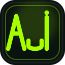

<p align="center">
  
</p>

<h1 align="center">Afaq Ul Islam — Portfolio</h1>

<p align="center">
  <strong>Agentic AI Engineer · Full-Stack Developer · Co-Founder &amp; COO at Neofyx</strong>
</p>

<p align="center">
  A premium, animated portfolio built with Next.js 15, TypeScript and Tailwind CSS —
  featuring a dimensional AUI monogram rendered with React Three Fiber, glassmorphism,
  a working Resend-powered contact form, and a fully static, SEO-first App Router build.
</p>

<p align="center">
  <a href="https://portfolio-landingpage-v2-aui.vercel.app">
    
  </a>
  <a href="https://github.com/afaqulislam/portfolio-landingpage-v2">
    
  </a>
  <a href="https://github.com/afaqulislam">
    
  </a>
  <a href="https://www.linkedin.com/in/afaqulislam">
    
  </a>
  <a href="https://x.com/afaqulislam707">
    
  </a>
  <a href="mailto:afaqulislam707@gmail.com">
    
  </a>
  <a href="https://portfolio-landingpage-v2-aui.vercel.app/Afaq_Ul_Islam_Resume.pdf">
    
  </a>
</p>

<p align="center">
  
  
  
  
  
  
  
</p>

<p align="center">
  <a href="https://github.com/afaqulislam/portfolio-landingpage-v2/stargazers">
    
  </a>
  <a href="https://github.com/afaqulislam/portfolio-landingpage-v2/network/members">
    
  </a>
  <a href="https://github.com/afaqulislam/portfolio-landingpage-v2/issues">
    
  </a>
  
  
</p>

<p align="center">
  <a href="https://portfolio-landingpage-v2-aui.vercel.app">
    
  </a>
  <br />
  <sub>Live preview - open the deployed portfolio</sub>
</p>

<div align="center">

https://github.com/user-attachments/assets/af988670-3a2e-4146-ac1d-48f2a520b6d4

<sub>Portfolio showcase · 62 s · full walkthrough</sub>

</div>

---

## Table of Contents

- [Overview](#overview)
- [Live Site](#live-site)
- [Highlights](#highlights)
- [Sections](#sections)
- [Tech Stack](#tech-stack)
- [Project Structure](#project-structure)
- [Getting Started](#getting-started)
- [Environment Variables](#environment-variables)
- [Contact Form API](#contact-form-api)
- [Scripts](#scripts)
- [SEO & Performance](#seo--performance)
- [Accessibility](#accessibility)
- [Deployment](#deployment)
- [Topics & Keywords](#topics--keywords)
- [FAQ](#faq)
- [Support](#support)
- [Author](#author)
- [Connect](#connect)
- [License](#license)

---

## Overview

This is the personal portfolio of **Afaq Ul Islam** — an Agentic AI Engineer, Full-Stack Developer and Co-Founder & COO at **Neofyx**. It presents selected AI and web work, engineering experience, education and milestones through a deliberately restrained design language: dark glass surfaces, a single lime accent (`#A6FF00`), fluid motion and an accessibility-first build.

The centrepiece is a **dimensional AUI monogram** in the hero, rendered with Three.js and React Three Fiber. It combines a dark chrome frame, a lime emissive core, orbital rings, reflective materials and a restrained floating motion. The scene loads on the client only and respects reduced-motion preferences.

## Live Site

| Resource | Link |
| -------- | ---- |
| Portfolio | [portfolio-landingpage-v2-aui.vercel.app](https://portfolio-landingpage-v2-aui.vercel.app) |
| Source | [github.com/afaqulislam/portfolio-landingpage-v2](https://github.com/afaqulislam/portfolio-landingpage-v2) |
| Resume | [Afaq_Ul_Islam_Resume.pdf](https://portfolio-landingpage-v2-aui.vercel.app/Afaq_Ul_Islam_Resume.pdf) |
| Email | [afaqulislam707@gmail.com](mailto:afaqulislam707@gmail.com) |

## Highlights

- **Dimensional hero logo** — dark chrome and lime emissive 3D monogram with orbital rings, layered depth and subtle motion.
- **Glassmorphism system** — double-bezel cards, film-grain overlay, layered depth and a cursor-tracked glass wordmark.
- **One constant accent** — a single lime hue applied consistently across every surface.
- **Working contact form** — client validation, sending, success and error states, delivered through Resend.
- **Content-driven** — all copy lives in `lib/data.ts`; edit content without touching JSX.
- **Responsive by default** — tuned for normal mobile, tablet, desktop-site mode and desktop widths.
- **SEO-first** — canonical URL, Open Graph and Twitter cards, JSON-LD, sitemap, robots and `llms.txt`.
- **Accessible** — semantic landmarks, skip link, keyboard navigation, visible focus rings and reduced-motion support.
- **Performance focused** — server-first components, static rendering, local fonts and GPU-only animation.

## Sections

| Section | Id | Highlights |
| ------- | -- | ---------- |
| Hero | `#home` | Dimensional AUI logo, tagline, CTAs, stats |
| About | `#about` | Personal intro and working principles |
| Skills | `#skills` | Tools and capabilities across the stack |
| Projects | `#work` | Project previews, live and GitHub links |
| Experience | `#experience` | Neofyx, internships and freelance work |
| Education | `#education` | University, GIAIC, college and SSC |
| Milestones | `#achievements` | Competition wins and open-source work |
| Contact | `#contact` | Resend-powered form and social links |

## Tech Stack

| Layer | Technology |
| ----- | ---------- |
| Framework | Next.js 15 (App Router) |
| Language | TypeScript |
| UI | React 19 |
| Styling | Tailwind CSS 3.4 |
| Icons | lucide-react |
| Fonts | Geist (local, via `next/font/local`) |
| Email | Resend REST API |
| 3D | Three.js, React Three Fiber, drei |
| Animation | React Three Fiber motion and CSS keyframes |
| Hosting | Vercel |

## Project Structure

```text
portfolio-landingpage-v2/
├─ app/
│  ├─ api/
│  │  └─ contact/route.ts    # Resend email delivery endpoint
│  ├─ components/            # Section and layout components
│  │  ├─ hero-logo.tsx       # Client-only 3D hero logo wrapper
│  │  ├─ hero-logo-scene.tsx # Three.js / React Three Fiber monogram scene
│  │  ├─ glass-wordmark.tsx  # Cursor-tracked footer wordmark
│  │  ├─ og-image.tsx        # Shared Open Graph / Twitter image
│  │  └─ ...                 # header, hero, about, skills, ...
│  ├─ fonts/                 # Geist variable fonts
│  ├─ globals.css            # Design tokens, utilities and base styles
│  ├─ favicon.ico            # Browser favicon
│  ├─ icon.svg               # App icon
│  ├─ apple-icon.png         # Apple touch icon
│  ├─ layout.tsx             # Root layout, metadata and JSON-LD
│  ├─ manifest.ts            # Web app manifest
│  ├─ opengraph-image.tsx    # Social share image
│  ├─ twitter-image.tsx      # X / Twitter share image
│  ├─ robots.ts              # robots.txt route
│  ├─ sitemap.ts             # sitemap.xml route
│  ├─ not-found.tsx          # Styled 404 page
│  └─ page.tsx               # Section composition
├─ lib/
│  ├─ data.ts                # All site content (edit here)
│  ├─ seo.ts                 # Site constants + JSON-LD structured data
│  └─ utils.ts               # `cn` class-merge helper
├─ public/
│  ├─ icons/                 # PWA icons (192, 512, maskable)
│  ├─ projects/              # Project preview SVGs
│  ├─ aui-mark.svg           # AUI monogram
│  ├─ llms.txt               # AI crawler summary
│  └─ Afaq_Ul_Islam_Resume.pdf
├─ tailwind.config.ts
└─ next.config.ts
```

## Getting Started

### Prerequisites

- Node.js **18.18** or newer
- npm

### Installation

```bash
# 1. Clone the repository
git clone https://github.com/afaqulislam/portfolio-landingpage-v2.git
cd portfolio-landingpage-v2

# 2. Install dependencies
npm install

# 3. Set up environment variables
cp .env.example .env
# → then fill in your RESEND_API_KEY

# 4. Run the development server
npm run dev
```

Open [http://localhost:3000](http://localhost:3000).

## Environment Variables

| Variable | Required | Default | Description |
| -------- | -------- | ------- | ----------- |
| `RESEND_API_KEY` | Yes | — | API key from [resend.com/api-keys](https://resend.com/api-keys) |
| `CONTACT_TO` | No | `afaqulislam707@gmail.com` | Destination inbox for contact messages |
| `RESEND_FROM` | No | `Afaq Ul Islam <onboarding@resend.dev>` | Verified sender shown in delivered emails |
| `NEXT_PUBLIC_SITE_URL` | No | `https://portfolio-landingpage-v2-aui.vercel.app` | Canonical URL for metadata, Open Graph and the contact-form origin check |
| `NEXT_PUBLIC_GOOGLE_SITE_VERIFICATION` | No | — | Optional Google Search Console verification token |

> **Note:** `onboarding@resend.dev` can only send to your own verified email. For other recipients, verify a domain in Resend and set `RESEND_FROM` to an address on that domain.

## Contact Form API

The form at `#contact` posts JSON to `POST /api/contact`, which validates the payload server-side and sends the email through the Resend REST API. No secrets are exposed to the client, and the route returns only generic, non-revealing errors.

Abuse protection includes:

- Origin checks
- In-memory rate limiting (5 requests per hour per IP)
- Honeypot field
- Payload size caps
- Request timeout

## Scripts

| Command | Description |
| ------- | ----------- |
| `npm run dev` | Start the development server (Turbopack) |
| `npm run build` | Create a production build |
| `npm run start` | Run the production build |
| `npm run lint` | Lint with ESLint |

## SEO & Performance

- Canonical URL, Open Graph and Twitter card metadata
- JSON-LD structured data: `Person`, `WebSite` and `ProfilePage`
- Generated `sitemap.xml`, `robots.txt` and web app manifest
- `llms.txt` summary for AI crawlers
- `noindex` on the 404 page
- Static rendering for the main page
- Local Geist fonts with `display: swap`
- Responsive images through `next/image`
- Edge-cached social share images
- GPU-only animations with `prefers-reduced-motion` support

## Accessibility

- Semantic landmarks and a skip-to-content link
- Keyboard-friendly navigation and focus-visible rings
- Descriptive labels on icon-only links
- `prefers-reduced-motion` respected across all motion
- Validated colour contrast on the dark palette

## Deployment

Deploys out-of-the-box on any Next.js host — easiest on **[Vercel](https://vercel.com/new)**:

1. Push this repository to GitHub.
2. Import it into Vercel.
3. Add the environment variables above under **Settings → Environment Variables**.
4. Deploy. No extra configuration is required.

[](https://vercel.com/new/clone?repository-url=https://github.com/afaqulislam/portfolio-landingpage-v2)

## Connect

<p>
  <a href="https://github.com/afaqulislam">
    
  </a>
  <a href="https://www.linkedin.com/in/afaqulislam">
    
  </a>
  <a href="https://x.com/afaqulislam707">
    
  </a>
  <a href="mailto:afaqulislam707@gmail.com">
    
  </a>
  <a href="https://portfolio-landingpage-v2-aui.vercel.app">
    
  </a>
</p>

## Topics & Keywords

This repository is a complete, production-ready example of a **Next.js developer portfolio**. It is a good reference if you are looking for:

- A **Next.js 15 portfolio website** built with the App Router and React Server Components
- A **React 19 + TypeScript portfolio** starter with strict typing
- A **Tailwind CSS personal portfolio** with a custom design-token system
- A **Three.js / React Three Fiber portfolio** with an interactive 3D hero logo
- A **glassmorphism, dark-mode portfolio** with accessible motion
- An **SEO-first portfolio** with JSON-LD, Open Graph, sitemap, robots and `llms.txt`
- A **full-stack portfolio** with a validated, Resend-powered contact form

Search terms people use to find projects like this: developer portfolio, personal portfolio website, portfolio landing page, Next.js portfolio, Next.js 15 portfolio, React portfolio, TypeScript portfolio, Tailwind CSS portfolio, 3D portfolio, Three.js portfolio, React Three Fiber portfolio, WebGL portfolio, glassmorphism UI, dark mode website, SEO portfolio, Vercel portfolio, Afaq Ul Islam.

If you build your own version from this reference, please keep the [license](#license) in mind.

## FAQ

<details>
<summary><strong>What is this project?</strong></summary>

This is the personal portfolio of **Afaq Ul Islam** — Agentic AI Engineer, Full-Stack Developer and Co-Founder & COO at Neofyx. It showcases selected AI and web projects, skills, experience, education and milestones, and includes a working contact form.

</details>

<details>
<summary><strong>Which technologies does it use?</strong></summary>

Next.js 15 (App Router), React 19, TypeScript, Tailwind CSS 3.4, Three.js with React Three Fiber and drei, lucide-react icons, local Geist fonts, the Resend REST API for email, and Vercel for hosting. See [Tech Stack](#tech-stack).

</details>

<details>
<summary><strong>How does the 3D hero logo work?</strong></summary>

The hero monogram is rendered with **Three.js and React Three Fiber** in a client-only scene. It uses a dark chrome frame, a lime emissive core, orbital rings and reflective materials, and it respects `prefers-reduced-motion` so the site stays usable and comfortable.

</details>

<details>
<summary><strong>Does the contact form actually send email?</strong></summary>

Yes. The form posts to `POST /api/contact`, which validates the payload server-side and sends mail through **Resend**. You need a `RESEND_API_KEY` in your environment for local or self-hosted use. See [Contact Form API](#contact-form-api).

</details>

<details>
<summary><strong>How is SEO handled?</strong></summary>

The build includes a canonical URL, Open Graph and Twitter cards, JSON-LD structured data (`Person`, `WebSite`, `ProfilePage`), generated `sitemap.xml` and `robots.txt`, a web app manifest, and an `llms.txt` summary for AI crawlers. See [SEO & Performance](#seo--performance).

</details>

<details>
<summary><strong>Can I use this project as a template?</strong></summary>

The code, design, copy and assets are **all rights reserved**. You may read and learn from the source, but copying, modifying, redistributing or using it commercially requires explicit written permission. See [License](#license).

</details>

<details>
<summary><strong>How do I run it locally?</strong></summary>

Clone the repository, run `npm install`, copy `.env.example` to `.env`, add your `RESEND_API_KEY`, then run `npm run dev` and open [http://localhost:3000](http://localhost:3000). See [Getting Started](#getting-started).

</details>

## Support

If this repository helped you or inspired your own portfolio:

- **Star** the repository so more developers can find it.
- **Share** it on LinkedIn or X.
- **Open an issue** for bugs, broken links or ideas.
- **Reach out** for collaboration, AI agent work or freelance projects.

<p align="center">
  <a href="https://github.com/afaqulislam/portfolio-landingpage-v2/stargazers">
    
  </a>
</p>

## Author

**Afaq Ul Islam** — Agentic AI Engineer, Full-Stack Developer, and Co-Founder & COO at **Neofyx**.

| Platform | Link |
| -------- | ---- |
| GitHub | [github.com/afaqulislam](https://github.com/afaqulislam) |
| LinkedIn | [linkedin.com/in/afaqulislam](https://www.linkedin.com/in/afaqulislam) |
| X | [x.com/afaqulislam707](https://x.com/afaqulislam707) |
| Email | [afaqulislam707@gmail.com](mailto:afaqulislam707@gmail.com) |
| Portfolio | [portfolio-landingpage-v2-aui.vercel.app](https://portfolio-landingpage-v2-aui.vercel.app) |

## License

**© 2026 Afaq Ul Islam. All rights reserved.**

This project is the personal property of **Afaq Ul Islam**. No part of this repository — code, design, copy or assets — may be copied, modified, redistributed or used commercially without explicit written permission from the author.

---

<p align="center">
  <strong>Have a product, AI agent or automation workflow in mind?</strong><br />
  Let's build something worth shipping.
</p>

<p align="center">
  <a href="https://github.com/afaqulislam">GitHub</a> ·
  <a href="https://www.linkedin.com/in/afaqulislam">LinkedIn</a> ·
  <a href="https://x.com/afaqulislam707">X</a> ·
  <a href="mailto:afaqulislam707@gmail.com">Email</a>
</p>

<p align="center">
  <sub>© 2026 Afaq Ul Islam · Crafted with Next.js, Tailwind CSS and a touch of lime.</sub>
</p>
